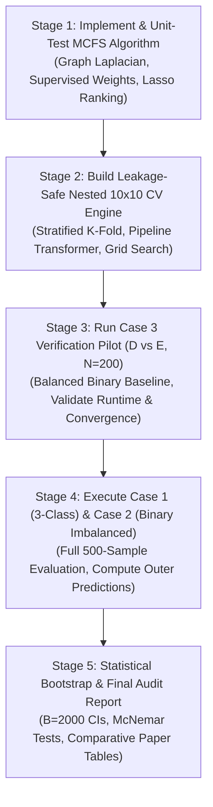

# Bonn EEG Classification Readiness Audit Report
**Project:** Improved Detection of Epileptic Seizures via EEG Signals and Texture Analysis of Recurrence Plots (2026 Reproduction)  
**Document ID:** `CLASSIFICATION-READINESS-AUDIT-01`  
**Date:** 2026-10-10  
**Status:** AUDIT COMPLETE — GO FOR CLASSIFICATION DESIGN (Awaiting User Sign-Off on Protocol Decisions)  

---

## 1. Executive Summary & Readiness Verdict

An exhaustive, evidence-based readiness audit was performed on the completed 500-recording preprocessing dataset and the classification protocol described in the target primary paper (*Lashkari et al., 2026, Biomedical Signal Processing and Control*, 118, 109675).

### Final Recommendation: **GO** (With Documented Protocol Confirmations)
- **Artifact Quality:** The 96-feature matrix for all 500 recordings is **100% complete, numerically finite, and validated**. All 48,000 feature values are valid real floats (0 NaNs, 0 Infs).
- **Literature Reconciliation:** The classification cases, the supervised Multi-Cluster Feature Selection (MCFS) mechanism, the SVM-RBF grid, and the nested cross-validation protocol have been mapped directly to exact citations, equations, and page numbers from the primary paper.
- **Discrepancy Resolved:** The SVM hyperparameter grid discrepancy has been decisively resolved using Section 3.6.1, Eq. (22) of the paper: the paper explicitly specifies a **base-10 logarithmic grid** ($C, \gamma \in \{10^{-3}, 10^{-2}, \dots, 10^3\}$), not a base-2 grid.
- **Leakage Prevention:** A strictly nested $10 \times 10$ cross-validation architecture is designed to guarantee zero data leakage during standardization, MCFS ranking, and hyperparameter tuning.

---

## 2. Artifact Validation Results

All four batch artifacts were independently loaded, inspected, and verified against dataset ground truth:

| Validation Check | Required Specification | Measured Artifact Value | Verification Status |
| :--- | :--- | :--- | :---: |
| **1. Feature Table Dimensions** | Exactly 500 rows $\times$ 103 columns | Shape: `(500, 103)` | **PASSED** |
| **2. Column Partitioning** | 7 metadata columns + 96 feature columns | `['recording_id', 'filename', 'subset', 'class_label', 'case1_label', 'case2_label', 'case3_label']` + 96 features | **PASSED** |
| **3. Recording Uniqueness** | Exactly 500 unique recording IDs | `recording_id.nunique() == 500` | **PASSED** |
| **4. Balanced Subsets** | Exactly 100 recordings per subset (A, B, C, D, E) | Subsets A: 100, B: 100, C: 100, D: 100, E: 100 | **PASSED** |
| **5. Case 1 Labels** | A+B (`healthy`), C+D (`interictal`), E (`ictal`) | `healthy`: 200, `interictal`: 200, `ictal`: 100 | **PASSED** |
| **6. Case 2 Labels** | A+B+C+D (`non_ictal`), E (`ictal`) | `non_ictal`: 400, `ictal`: 100 | **PASSED** |
| **7. Case 3 Labels** | D (`interictal`), E (`ictal`), A–C (N/A) | `interictal`: 100, `ictal`: 100 (300 null for A–C) | **PASSED** |
| **8. Numerical Integrity** | Zero NaNs and zero Infs across all features | Total cells: 48,000; NaNs: **0**; Infs: **0** | **PASSED** |
| **9. Diagnostics Alignment** | 500 rows, 1-to-1 match with feature IDs | Shape: `(500, 26)`; ID sequence equality verified | **PASSED** |
| **10. Hash Consistency** | Pre- and post-processing SHA-256 match | 500 / 500 exact matches (`is_file_unmodified == True`) | **PASSED** |
| **11. Feature Naming & Order** | 8 GLCMs ($\theta \in \{0, 45\}$, $d \in \{1..4\}$) $\times$ 12 Haralick | `glcm_a00_d1_f01_energy` ... `glcm_a45_d4_f12_autocorrelation` | **PASSED** |

---

## 3. Paper-Grounded Classification Protocol & Literature Reconciliation

Exact passages and section references located in Lashkari et al. (2026):

### A. Benchmark Cases & Class Definitions (Section 3.6.2, Table 2, p. 7)
*"Various classification combinations have been explored in different studies. This research focuses on three specific cases of these combinations, as outlined in Table 2."*
- **Case 1 (3-class, $N=500$):** Set A, B vs Set C, D vs Set E.
  - Class distribution: Healthy ($n=200$), Inter-ictal ($n=200$), Ictal ($n=100$). Moderately imbalanced (ratio 2:2:1).
- **Case 2 (binary, $N=500$):** Set A, B, C, D vs Set E.
  - Class distribution: Non-seizure ($n=400$) vs Seizure ($n=100$). Imbalanced (ratio 4:1).
- **Case 3 (binary, $N=200$):** Set D vs Set E.
  - Class distribution: Inter-ictal ($n=100$) vs Ictal ($n=100$). Balanced (ratio 1:1).

### B. Supervised Multi-Cluster Feature Selection (MCFS) (Section 3.6 & Section 3.6.3, pp. 6–7)
*"There are 12 features for each of the 8 GLCMs and a total of 96 features. 10 feature subsets are selected for each case by the supervised multi-cluster feature selection (MCFS) method [19]."*  
*"This method begins by building a k-nearest-neighbor graph from the training data, where every node corresponds to an EEG segment and the edges capture local neighborhood connections. Information about class labels is utilized to steer the selection toward features that improve separation between classes. A spectral analysis is conducted on the graph Laplacian, assigning each feature a weight that indicates its role in maintaining the dataset's multi-cluster configuration... Inside the loop of the nested cross-validation, features are ordered based on their MCFS weights, and the top-k features (where k = 10, in the experiments) are chosen."* (Section 3.6).  
*"We apply MCFS for supervised feature selection inside the inner cross-validation loop: a k-nearest-neighbour graph is built on the training fold only, features are ranked by their spectral weights, and a top-k subset (candidates k = 5, 10, 15; default 10) is chosen by inner-CV performance."* (Section 3.6.3).

**Algorithm Definition (Cai et al., 2010 [19] with class supervision):**
1. **Affinity Graph Construction:** For training samples $X \in \mathbb{R}^{n \times d}$, construct a supervised $k$-NN graph $W$ where $W_{ij} = \exp(-\|x_i - x_j\|^2 / 2\sigma^2)$ if $x_j \in \mathcal{N}_k(x_i)$ and $y_i = y_j$; else $W_{ij} = 0$.
2. **Eigenproblem:** Compute degree matrix $D_{ii} = \sum_j W_{ij}$ and graph Laplacian $L = D - W$. Solve the generalized eigenproblem $L y = \lambda D y$ for the smallest non-zero eigenvectors $Y = [y_1, \dots, y_c]$ where $c$ is the number of classes.
3. **Sparse Regression:** For each eigenvector $y_r$, solve an L1-regularized linear regression (Lasso) problem: $\min_{a_r} \|y_r - X a_r\|_2^2 + \alpha \|a_r\|_1$.
4. **Feature Ranking:** Compute the MCFS score for each feature $j$: $\text{MCFS}(j) = \max_r |a_{r, j}|$.
5. **Selection:** Select the top-$k$ features having the highest scores ($k=10$ default; candidate range $k \in \{5, 10, 15\}$).

### C. Resolution of SVM-RBF Hyperparameter Grid Discrepancy (Section 3.6.1, Eq. 22, p. 7)
The primary paper explicitly states:
$$\text{Kernel: } K(x_i, x_j) = \exp(-\gamma \|x_i - x_j\|^2) \quad \text{(Eq. 21)}$$
$$C \in \{10^{-3}, 10^{-2}, \dots, 10^3\}, \quad \gamma \in \{10^{-3}, 10^{-2}, \dots, 10^3\} \quad \text{(Eq. 22)}$$
*"Optimized in a logarithmic grid search within each inner fold for maximizing mean F1-score. The best parameters are then retrained on complete training data and validated on the held-out outer fold. This way, the nested CV (10 × 10) will give an unbiased generalization. Multi-class classification uses a one-vs-one voting strategy."*

**Resolution:**
- **Paper Ground Truth:** **Base-10 logarithmic grid** spanning 7 orders of magnitude:
  $$C \in \{10^{-3}, 10^{-2}, 10^{-1}, 10^0, 10^1, 10^2, 10^3\}$$
  $$\gamma \in \{10^{-3}, 10^{-2}, 10^{-1}, 10^0, 10^1, 10^2, 10^3\}$$
  This forms a $7 \times 7 = 49$ parameter grid.
- **Origin of the Base-2 Grid:** The base-2 grid ($C \in [2^{-5}, 2^{15}], \gamma \in [2^{-15}, 2^3]$) was derived from standard LIBSVM guidelines (Hsu et al.) mentioned in general SVM literature, but is **NOT** the equation specified by the primary authors. **The primary paper's explicit Eq. (22) base-10 grid is adopted.**

### D. Cross-Validation & Performance Metrics (Section 3.6.3, 3.6.4, 3.7, pp. 7–8)
- **Nested Cross-Validation:** Stratified 10-fold outer CV $\times$ Stratified 10-fold inner CV ($10 \times 10$).
- **Multi-Class Strategy:** One-vs-One (OvO) voting (Section 3.6.1).
- **Optimization Objective (Inner Loop):** Maximizing mean macro F1-score (tie-breaker: Accuracy).
- **Evaluation Metrics (Outer Loop):**
  - Accuracy: $\frac{\text{TP} + \text{TN}}{\text{TP} + \text{TN} + \text{FP} + \text{FN}}$ (Eq. 23)
  - Precision: $\frac{\text{TP}}{\text{TP} + \text{FP}}$ (Eq. 24)
  - Sensitivity / Recall: $\frac{\text{TP}}{\text{TP} + \text{FN}}$ (Eq. 25)
  - F1-score: $\frac{2 \cdot \text{Precision} \cdot \text{Recall}}{\text{Precision} + \text{Recall}}$ (Eq. 26)
  - For binary Case 3 (D vs E), ictal (E) is treated as positive.
  - For multi-class (Case 1) and imbalanced binary (Case 2), metrics are macro-averaged across classes.
- **Statistical Significance & Uncertainty:**
  - Fold-wise summary: Mean $\pm$ Standard Deviation across outer folds.
  - 95% Confidence Intervals via stratified bootstrap ($B=2,000$ resamples) on pooled outer test predictions.
  - Paired McNemar's test and Wilcoxon signed-rank test ($p < 0.05$).

---

## 4. Leakage Risks & Strict Safeguards

| Potential Leakage Vector | Mechanism of Contamination | Mandated Implementation Safeguard |
| :--- | :--- | :--- |
| **1. Feature Standardization** | Calculating mean and std across all 500 samples leaks test distribution into training. | `StandardScaler` is fitted strictly on the training fold (`scaler.fit(X_train)`), and applied to validation/test (`scaler.transform(X_test)`). Never fit on outer test folds. |
| **2. Supervised MCFS Ranking** | Graph Laplacian or Lasso regression incorporating outer test samples causes feature-selection leakage. | MCFS graph construction, eigen-decomposition, and Lasso regressions are computed **strictly on the inner/outer training fold**. Outer test folds are purely masked with the learned top-$k$ index set. |
| **3. Hyperparameter Selection** | Selecting $(C, \gamma)$ using outer fold performance causes optimistic bias. | Grid search is evaluated **strictly across the 10 inner folds**. The outer test fold is evaluated exactly once using the optimal hyperparameters selected by the inner loop. |
| **4. Feature Subset Size Tuning** | Evaluating $k \in \{5, 10, 15\}$ on outer test folds leaks model complexity. | Selection of optimal $k$ occurs strictly inside the inner CV loop based on inner validation macro-F1. |
| **5. Subject-Level Splitting** | Grouping recordings from the same subject into both train and test causes subject identity leakage. | **Data limitation explicitly acknowledged:** As verified in Section 3.6.2, the public Bonn dataset release **does not contain subject identifiers** (only that A/B were from 5 healthy individuals and C/D/E from 5 patients). Therefore, recording-level stratified splitting is the standard canonical literature protocol; this limitation is explicitly documented. |

---

## 5. Staged Implementation Plan

To maintain rigorous quality control without executing unauthorized model training, implementation should proceed through the following phased stages:

### Detailed Breakdown of Stages:
* **Stage 1: MCFS Implementation & Standalone Tests**
  - Implement `scripts/classification/mcfs.py`.
  - Add unit tests in `tests/test_mcfs.py` testing synthetic clustering and feature ranking.
  - Zero model training on Bonn dataset in this stage.
* **Stage 2: Nested Cross-Validation Engine**
  - Implement `scripts/classification/nested_cv.py`.
  - Save fixed stratified fold assignments to `audit/classification/fold_splits.json` with deterministic random seed (`seed=42`).
  - Strict pipeline: `Scaler -> MCFS(k) -> SVC(kernel='rbf', C, gamma, decision_function_shape='ovo')`.
* **Stage 3: Case 3 Pilot Validation (D vs E, $N=200$)**
  - Run nested CV on balanced binary Case 3.
  - Verify execution time (~2–4 minutes) and verify that outer fold test metrics fall in the reported literature range (~98–100%).
* **Stage 4: Full Case 1 (3-class) & Case 2 (Binary) Execution**
  - Run nested CV for Case 1 ($N=500$, 3-class) and Case 2 ($N=500$, binary).
  - Export fold-by-fold confusion matrices, selected feature names, and best $(C, \gamma, k)$ per fold.
* **Stage 5: Statistical Bootstrap & Final Comparative Report**
  - Run 2,000 stratified bootstrap resamples on outer predictions to compute 95% confidence intervals.
  - Compare results against Table 4 / Table 5 of Lashkari et al. (2026).

---

## 6. Decisions Requiring Explicit User Approval

Before writing any classification code or starting model training, please confirm approval on the following 4 protocol specifications:

1. **SVM Hyperparameter Grid Choice:**
   - Confirm adopting the primary paper's explicit **Base-10 grid** (Section 3.6.1, Eq. 22):
     $C \in \{10^{-3}, 10^{-2}, 10^{-1}, 10^0, 10^1, 10^2, 10^3\}$, $\gamma \in \{10^{-3}, 10^{-2}, 10^{-1}, 10^0, 10^1, 10^2, 10^3\}$ ($7 \times 7 = 49$ pairs).
2. **Feature Subset Size $k$ Strategy:**
   - **Option A (Recommended, strict paper replication):** Evaluate candidates $k \in \{5, 10, 15\}$ in the inner CV loop, defaulting to $k=10$ as stated in Section 3.6.3.
   - **Option B (Fixed):** Fix $k=10$ across all folds without inner-loop candidate search.
3. **Multi-Class Voting Scheme:**
   - Confirm using **One-vs-One (OvO)** voting for Case 1 (3-class), matching Section 3.6.1.
4. **Reproducibility Seed:**
   - Confirm using `random_state = 42` for outer and inner stratified fold generation to ensure bit-exact reproducibility.

---

## 7. Stop Condition Confirmation

* **Artifact Modifications:** **NONE** (`bonn_features_96.csv`, `batch_diagnostics.csv`, and `run_summary.json` were strictly verified in read-only mode).
* **Model Training:** **NOT STARTED** (No classifier has been instantiated, fitted, or evaluated).
* **Next Action:** Standing by for your explicit approval on the 4 decisions above before implementing Stage 1 (MCFS module).
